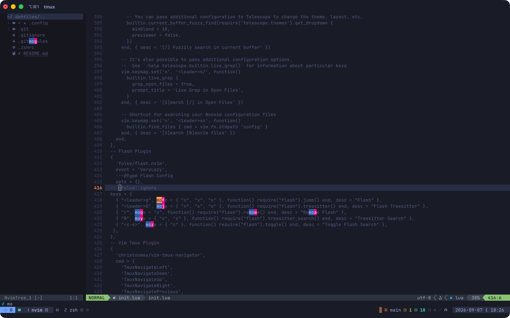

# My dotfiles

This directory contains the dotfiles for my system

## What's here

- **Neovim** — forked from [kickstart.nvim](https://github.com/nvim-lua/kickstart.nvim). 
  Added [flash.nvim](https://github.com/folke/flash.nvim) (`<leader>g`) to jump 
  anywhere on screen in a couple keystrokes instead of hunting with `/` search, 
  plus nvim-tree as a persistent file sidebar. tokyonight colorscheme, 
  centered-scroll and buffer-cycling keymaps.



- **Zsh** — Zinit-managed, Powerlevel10k prompt, vi-mode. Autosuggestions 
  guess full commands from history as I type. Zoxide tracks directories 
  I actually use so `cd` works off partial/fuzzy names instead of full paths.


- **Tmux** — vi-mode copy/paste, pane splitting (side-by-side or stacked), 
  and persistent sessions via tmux-resurrect + tmux-continuum — sessions 
  survive a reboot and restore automatically when I open a terminal.
- **Aerospace** — tiling window manager, keyboard-only. Specific apps are 
  pinned to specific workspaces so my layout is already organized before I 
  even open anything — most-used stuff always lands in the same place, 
  everything else shares the remaining space. 

## Requirements

Ensure you have the following installed

### Git

```
brew install git
```

### Stow

```
brew install stow
```

### Tmux

```
brew install tmux
git clone https://github.com/tmux-plugins/tpm ~/.tmux/plugins/tpm
```

## Mac Settings

### Hide Dock via cli

```
defaults write com.apple.dock autohide -bool true && killall Dock
```

### Make it only appear if you float over it with the mouse for 10 seconds (use 4 fingers up gesture to make it appear)

```
defaults write com.apple.dock autohide-delay -float 10000 && killall Dock
```

## Installation

First, copy the dotfiles repo into $HOME using git

```
$ git clone git@github.com/Qu1nn1/dotfiles.git
$ cd dotfiles
```

then use stow to create symlinks

```
$ stow .
```
